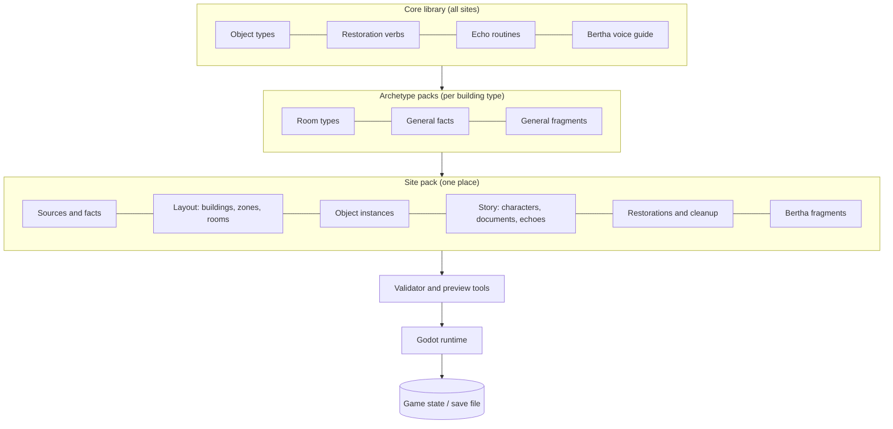

# Data Model Proposal

**Status:** Draft proposal. The Godot core slice implements a first version of this model in JSON; see `CLAUDE.md`.
**Scope:** How Still Here describes places, objects, history, story, state and Bertha's answers, and how that structure is reused for future sites.

---

## Goals

1. **One source of truth.** The same data drives what the player sees, what Bertha says, and what's saved.
2. **Honest history.** Every historical claim traces back to a source. Anything invented is labeled invented.
3. **Content that grows linearly.** Bertha's answers are assembled from small conditional fragments, never pre-written for every combination of states.
4. **Built for more than one site.** Knowledge that applies to many places (what a piano is, how Kirkbride wards worked, how "place" restorations behave) is written once and inherited. A new site only adds what makes it unique.
5. **LLM as an offline writing partner, never at runtime.** LLMs propose and draft; a person reviews and approves; approved text lives in the repo.
6. **Machine-checkable.** A validator catches broken references, missing hints and unsourced history before they reach the game.

---

## The big picture



Three tiers, from most general to most specific:

| Tier | What it holds | Example | Reused by |
|---|---|---|---|
| **Core** | Object types, restoration verbs, echo routines, cleanup types, Bertha's voice, the condition language | "upright piano", `place`, `sway`, `pile` | Every site |
| **Archetype** | Knowledge about a *kind* of building: its room types, typical contents, general history | Kirkbride asylum: ward dining rooms with dumbwaiters, attendant's rooms | Every site of that kind |
| **Site** | One real place: sources, facts, layout, specific objects, story, puzzles, site-specific text | Northern Michigan Asylum, Building 50, Ward 3 North | That site only |

A second Kirkbride asylum inherits the whole Kirkbride archetype for free. A school or a factory gets its own archetype, but still inherits all of Core.

**Promotion rule:** anything written for a site that turns out to be useful elsewhere gets moved up a tier. After site one, a lot of what's now site-specific will move into Core or the Kirkbride archetype. That's how each new site gets cheaper.

---

## Folder layout

```text
data/
  core/
    object_types/            # one file per family: furniture.yaml, fixtures.yaml, personal.yaml ...
    verbs.yaml               # place, upright, sweep, scrub, read, use, repair ...
    cleanup_types.yaml       # pile, grime_layer
    routines.yaml            # echo poses and loops: sit, stand, sway, play, write, sip, pour
    conditions.md            # the condition language spec
    voice/bertha.md          # Bertha's style guide and length budgets
  archetypes/
    kirkbride_asylum/
      archetype.yaml
      room_types.yaml        # ward_corridor, day_room, dining_room, single_room, attendant_station ...
      facts.yaml             # general Kirkbride facts, each sourced
      fragments/             # generic Bertha fragments per room type and object type
  sites/
    northern_michigan_asylum/
      site.yaml
      sources.yaml
      facts.yaml
      buildings/
        b50/
          building.yaml
          zones/
            w3n/             # Ward 3 North
              zone.yaml      # layout spec, presence settings, signal
              rooms.yaml
              objects.yaml
              restorations.yaml
              cleanup.yaml
              echoes.yaml
              fragments.yaml
      story/
        characters.yaml
        documents.yaml       # notes, letters, day book pages, pencil writing
      tunnels/ ...
tools/
  validate                   # schema and reference checks
  preview_bertha             # print Bertha's answer for a given state
  draft                      # LLM-assisted drafting helpers (offline)
```

Files are YAML: easy to diff, easy for people and LLMs to read and write. Godot loads them at startup (or an import step converts them to Godot resources). Nobody hand-edits generated Godot resources.

---

## IDs and provenance

### IDs
Every entity has a stable, namespaced, dotted ID:

```text
nma                              site
nma.b50                          building
nma.b50.w3n                      zone (Ward 3 North)
nma.b50.w3n.station              room or feature
nma.b50.w3n.station.bell         object instance
kirkbride.fact.ward_dining_room  archetype fact
core.type.upright_piano          object type
```

Inside a file, IDs can be written relative (`station.bell`) and are expanded by the loader. Godot scene nodes carry their ID in node metadata (`still_here_id`), which is the only link between the 3D scene and the data.

### Provenance
Anything that represents the world carries a `basis`:

| Value | Meaning | Example |
|---|---|---|
| `sourced` | Directly supported by a cited source | Building 50 opened in 1885 |
| `inferred` | Not documented for this exact place, but consistent with sourced period practice | A piano in a Kirkbride day room |
| `invented` | Created for the game | Margaret Hale, the Ward 3 North choir roster |

The journal uses this to show players what's real. The validator uses it to stop invented content from being presented as history.

---

## Entities

### Source
Where a fact comes from.

```yaml
- id: src.sah_archipedia_gtc
  title: "SAH Archipedia: Grand Traverse Commons"
  url: https://sah-archipedia.org/node/14840
  kind: web            # web | book | archive | photo | plan | site_visit
  accessed: 2026-10-14
```

### Fact
One short, checkable statement. History in Bertha's answers and the journal must reference facts, not restate the world from memory.

```yaml
- id: nma.fact.bay_views
  text: "Building 50's wings step back from the center so every ward had a view of Grand Traverse Bay."
  sources: [src.sah_archipedia_gtc]
  confidence: high     # high | medium | low
  tags: [architecture, kirkbride, views]
```

### Site, Building, Zone, Room
The physical hierarchy. "Zone" is deliberately generic: a ward, a wing, a floor, a tunnel run, a gym, a factory bay. Zones nest.

```yaml
# zone.yaml
id: w3n
name: Ward 3 North
parent: b50
basis: invented                  # the ward number is ours; the wing is real
layout:
  generator: kirkbride_ward      # which layout generator builds this zone
  source_plan: src.b50_original_plan
  corridor: { length_m: 36, width_m: 3.6, ceiling_m: 4.0 }
  north: [ ... segments: rooms, alcoves, solid walls, doors, windows ... ]
  south: [ ... ]
signal: { default: full, dead_spaces: [] }
presence: { start: 0.0, drives: [fog, ambient, wall_tint, lights, decay, sound] }
```

```yaml
# rooms.yaml
- id: station
  type: kirkbride.room.attendant_station
  name: Nurses' station
  basis: inferred
- id: dayroom
  type: kirkbride.room.day_room
  name: Day room
  basis: inferred
```

### Object type (Core or archetype)
What a kind of thing *is*, everywhere. Defines its possible states, which verbs apply, and generic knowledge.

```yaml
- id: core.type.upright_piano
  name: upright piano
  states: [present]
  photo: { max_distance_m: 5.5, center_tolerance: 0.55 }
  facts: [core.fact.upright_piano_common_1900s]
  fragments: [core.frag.upright_piano.ident]
- id: core.type.call_bell
  name: brass call bell
  states: [missing, carried, placed]
  verbs: [place, use]
```

### Object instance (site)
A specific thing in a specific place. Inherits from its type; adds specifics, placement, and links to story.

```yaml
- id: station.bell
  type: core.type.call_bell
  basis: invented
  home: { room: station, anchor: counter_right }   # where it belongs
  start: { state: missing, found_at: { room: room4, anchor: by_radiator } }
  document: story.doc.bell_inscription             # what reading it reveals
  dust_shadow: round_small                          # shadow left where it belonged (none: the model it sits on has one baked in)
- id: dayroom.piano.plate
  type: core.type.makers_plate
  parent: dayroom.piano
  basis: invented
  photo: { detail: true, max_distance_m: 1.6, center_tolerance: 0.3 }
```

### Restoration
A change the player can make, built from a Core verb. Restorations can depend on each other and can be grouped.

```yaml
- id: station.restore.bell
  verb: place
  object: station.bell
  requires: []                 # other restorations or flags that must come first
  hints: [station.frag.hint_bell_1, station.frag.hint_bell_2]
- id: station.restore.all
  group: [station.restore.lamp, station.restore.logbook, station.restore.bell, station.restore.chair]
  on_complete: [echo: station.echo.night_nurse, presence: { zone: w3n, add: 0.25 }]
```

Multi-step puzzles are just restorations with `requires`, plus objects with more states (`broken → repaired`).

### Cleanup target
Built from a Core cleanup type.

```yaml
- id: room2.pile
  type: core.cleanup.pile
  covers: room2.lamp            # the object stays locked until cleared
  hold_seconds: 3.0
- id: corridor.paint
  type: core.cleanup.grime_layer
  surface: w3n.corridor.north_wall.seg_12
  reveals: story.doc.choir_roster
  complete_at: 0.93
```

### Character, Document (story, composites)

The premise: the player arrives knowing the building and nothing about the people. The people are what the game slowly exposes, through **traces**: anything the player can encounter that is *about* someone. A character's page in the journal (see below) is assembled from the traces the player has actually found.

```yaml
- id: story.char.margaret_hale
  name: Margaret Hale, R.N.
  role: night nurse, Ward 3 North
  basis: invented                  # the loader refuses any other value
  notes: "Composite. Kept the lamp on all night. Wrote people's names, never numbers."
  closing: "Margaret Hale worked nights on Ward 3 North for longer than anyone wrote down. ..."

- id: story.doc.choir_roster
  kind: pencil_on_plaster
  author: story.char.margaret_hale
  basis: invented
  about: [story.char.dorothy, story.char.edna, ...]   # whose page this document belongs on
  label: "Pencilled on the corridor wall"              # how the journal names the source
  text: |
    Ward 3 North Day Room Choir, 1953
    Dorothy · Edna · Clara · Ida · Mae
    Lottie · Mrs. D. (loudest!)
    Sopranos to the LEFT of the piano, please. — M.H.
```

Traces are tagged, never duplicated:

- **A document** carries `about` (and an optional `label`; the title is used otherwise). A document with several entries splits them with `excerpts`, each with its own `about`, `label` and `text`; only the excerpts about a person reach their page, while the note overlay still shows the document whole. Echo captions are documents (`kind: caption`) and carry `about` the same way.
- **A Bertha fragment** carries `about`. Its label defaults to "Bertha, *subject title*". Tag only fragments the player can always still get: a connection whose condition can lapse (`not done(...)`, `carried(...)`) would leave a page that can never complete.
- **An echo figure** carries `character` and a `label` ("Seen at the bay window, watching the water"). The trace has no text; it records that the player stood near the revealed echo.

A trace is **found** when the document is in `State.read`, the fragment in `State.told`, or the echo in `State.seen` (revealed, and the player has been within its glimpse radius since). `closing` is the paragraph shown only once every trace tagged for that person has been found. It is a portrait, not a reward message.

Documents can also be read in place, with the `read` verb: a restoration with `verb: read` shows the object's document when used and changes nothing else (no state, no slot, no presence). Ruth's letter on the day room bench is one.

### Echo group
Residents tied to a restoration. No field exists for interacting with or noticing the player, by design.

```yaml
- id: dayroom.echo.choir
  trigger: dayroom.restore.hymnal
  color: "#ffe9c4"
  sound: core.sound.hymn_new_britain
  caption: story.caption.dayroom_snow_day
  figures:
    - { pose: seated, routine: play, at: piano_bench }
    - { pose: standing, routine: sway, at: around_piano, count: 5 }
    - { pose: seated, routine: still, at: bay_window_bench, character: story.char.ruths_mother }
  glimpse: { radius_m: 7, chance_per_s: 0.1 }
```

### Cue
Proximity hints before a place is restored.

```yaml
- id: dayroom.cue
  until: dayroom.restore.hymnal
  radius_m: 6
  sound: { ref: core.sound.hymn_new_britain, muffled: true, max_gain: 0.22 }
  visual: { motes: warm, edge_glow: true }
```

### Fragment (Bertha's answers)
The core of the phone mechanic. A fragment is a small piece of text attached to a photo subject, with a slot, a condition, and optionally the facts it relies on.

```yaml
- id: station.frag.hint_lamp_1
  subject: station
  slot: hint                         # ident | observation | connection | history | hint | special
  when: missing(station.lamp) and hint_level(station.restore.lamp) == 1
  text: "Night staff often kept a lamp burning at the station, so anyone who woke frightened could see someone was there."
  basis: inferred
- id: station.frag.history_attendant
  subject: station
  slot: history
  facts: [kirkbride.fact.attendant_room_per_ward]
  text: "Kirkbride's ward plan called for an attendant's room on every ward, close enough to keep watch at night."
```

A **connection** ties the photo to something the player has already found, using `read(doc)` and `told(fragment)`:

```yaml
- id: dining.conn_day_book
  subject: dining
  slot: connection
  when: read(doc.day_book)
  basis: invented
  text: "Mrs. D. ate all of her supper, the day book said. First time since February. It would have been at this table."
```

Connections are what make Bertha feel like she is paying attention, and they carry a rule: **Bertha knows the building from the facts tier, and knows the people only from what the player has shown her.** No fragment names a resident, a nurse or an initial unless its condition requires the document (or earlier fragment) that introduced it. Connections are not hints: they never raise hint levels, and the length budget drops them last.

Fragments live at all three tiers:

- **Core:** generic, per object type ("An upright piano, probably a hundred years old or more").
- **Archetype:** per room type and building type (what a Kirkbride day room was for).
- **Site:** specific to this place and story (the clean rectangle where the hymnal sat).

When the player photographs a subject, fragments are gathered from all three tiers. A site fragment in the same slot overrides the generic one. A piano at a brand-new site still gets a reasonable answer from Core before anyone writes a word for that site.

---

## State

The runtime state is small, flat, and is the save file.

```yaml
objects:
  nma.b50.w3n.station.bell: placed
  nma.b50.w3n.room2.lamp: carried
restorations:
  nma.b50.w3n.station.restore.bell: done
cleanup:
  nma.b50.w3n.corridor.paint: 0.41      # progress 0..1
zones:
  nma.b50.w3n: { presence: 0.5 }
echoes:
  nma.b50.w3n.station.echo.night_nurse: revealed
read:                                   # documents seen: found notes and echo captions
  nma.story.doc.lamp_note: 1            # the value is an encounter stamp (1, 2, 3...): the order found
told:                                   # fragments Bertha has delivered (with signal)
  nma.b50.w3n.station.hint_lamp_1: 2
seen:                                   # echoes the player has stood near once revealed
  nma.b50.w3n.station.echo.night_nurse: 3
player:
  carried: [nma.b50.w3n.room2.lamp]
  photos:
    - { subject: nma.b50.w3n.dayroom.piano, state_hash: "...", image: "photos/0007.png", answered: true }
  hint_levels:
    nma.b50.w3n.station.restore.lamp: 2
  flags: [ghost_shot_dayroom]
```

### The condition language
Kept deliberately tiny so the validator can parse and check it:

| Expression | True when |
|---|---|
| `missing(obj)`, `placed(obj)`, `carried(obj)` | the object is in that state |
| `state(obj) == "repaired"` | general state check |
| `done(restoration)` | a restoration is complete |
| `clean(target)` / `progress(target) >= 0.5` | cleanup progress |
| `presence(zone) >= 0.5` | zone presence |
| `hint_level(restoration) >= n` | escalation level |
| `photos(subject) >= n` | how many times the subject was photographed |
| `revealed(echo)` | an echo group is visible |
| `flag(name)` | a one-off story flag |
| `read(doc)` | the player has seen that document: a found note, or an echo's caption |
| `told(fragment)` | Bertha has delivered that fragment (a no-signal answer counts once it arrives) |
| `signal()` | the player currently has signal |

Combined with `and`, `or`, `not`. No arithmetic, no loops.

---

## How Bertha answers a photo

1. **Detect the subject.** Candidates are objects and features with a `photo` block. Filter by distance, screen position and occlusion; prefer detail subjects over wide ones; prefer the most centered.
2. **Snapshot the state.** Capture the relevant state at the moment of the photo. This matters for no-signal photos: an answer delivered later must still describe what the photo showed, not what the room looks like now.
3. **Gather fragments** for the subject from site, archetype and core tiers.
4. **Filter by condition** against the snapshot.
5. **Assemble by slot**, in order: `ident → observation → connection → history → hint → special`. Within a slot, the highest-priority fragment wins; site overrides archetype overrides core. At most one hint and one connection per answer.
6. **Apply the length budget** from Bertha's voice guide (for example, three short paragraphs): drop history first, then extra observations, then the connection.
7. **Deliver.** If there's signal, stream it. If not, queue it with the snapshot and deliver when signal returns.
8. **Update knowledge.** Record the photo; raise hint levels for unsolved restorations the subject is linked to; record before/after pairs. When the answer is actually delivered, record its fragments as `told`.

### Hint escalation
- A restoration's hint level starts at 1.
- It rises when the player photographs a linked subject again while the restoration is still unsolved (optionally after some minimum time).
- Each level maps to a fragment. Level 1 is history that implies; level 2 narrows the search; there is never a level that simply states the answer.
- Some subjects have no hint fragments at all, only history, so the player keeps reading for the story.

## The journal

The phone's **G** screen has two tabs: **Photos** (the gallery) and **People**. People lists characters in the order the player first met them, and nobody is listed before a trace of them has been found, so the player never sees how many there are. A person's page shows their name as the ward knew them, their role, then the found traces in the order found, each under its source label. While traces remain it ends with a single line, "There is more to find."; once every trace is found it ends with the character's `closing`. No counters, no checkmarks, no progress bars anywhere.

The assembly is pure over the data and the state (`scripts/phone/journal.gd`): gather every trace `about` the character, split by whether its record has a stamp, sort the found ones by stamp. `--journal-check` prints it headlessly for any `--read` / `--told` / `--seen` / `--read-all` state.

### Rare specials
One-off lines like the ghost photo are `special` fragments guarded by a flag, so they fire once:

```yaml
- id: dayroom.frag.ghost_photo
  subject: dayroom.piano
  slot: special
  when: not revealed(dayroom.echo.choir) and not flag(ghost_shot_dayroom)
  effects: [render_echo_in_photo: { echo: dayroom.echo.choir, reveal: 0.34 }, set_flag: ghost_shot_dayroom]
  text: "One more thing. There appear to be several people standing around the piano in your photo..."
```

---

## The content pipeline (repeatable per site)

Each step says who does the work. The aim is that steps move from "human-led" toward "automated, human-reviewed" as Core and the archetypes fill up.

| # | Step | Output | LLM role | Human role | Tooling |
|---|---|---|---|---|---|
| 1 | **Research** | `sources.yaml`, `facts.yaml` | Finds and summarizes sources, drafts candidate facts with citations | Verifies every fact against its source | Fact checker: every fact has a source |
| 2 | **Choose the archetype** | site links to an archetype | Suggests a match (Kirkbride asylum, cottage plan, school, factory) | Confirms, or starts a new archetype | |
| 3 | **Layout** | `zone.yaml` layouts | Proposes segments from plans and descriptions (later: vision-assisted plan tracing) | Traces or corrects against the real plan | Layout generator, 2D preview |
| 4 | **Room inventories** | `rooms.yaml`, `objects.yaml` | Proposes contents from archetype room types, facts and period photos, with `basis` | Approves, trims, adds | Validator flags unknown object types |
| 5 | **Story** | characters, documents, echoes | Drafts composites and documents in the project's tone | Leads: this is the heart of the game | Provenance check: all `invented` |
| 6 | **Restorations and puzzles** | `restorations.yaml`, `cleanup.yaml` | Suggests puzzles grounded in the history | Leads design | Dependency checker: every restoration is reachable |
| 7 | **Bertha's fragments** | `fragments.yaml` | Drafts fragments from facts, objects, states and the voice guide | Edits for voice and accuracy | Coverage report, length budget |
| 8 | **Validate and preview** | reports | | Reads previews | `validate`, `preview_bertha` |
| 9 | **Build scenes** | Godot scenes | | Art and lighting pass | Scene generator from layout + modular kit |

### What gets cheaper with each site
- **Site one:** almost everything is new. Core, the Kirkbride archetype and the tools get built alongside it.
- **Site two (another Kirkbride asylum):** reuses Core and the archetype. New work is mostly research, layout, story, puzzles and site-specific fragments.
- **Site three (a different building type):** a new archetype, but Core, the tools, the pipeline and the lessons all carry over.

After each site, a short **lessons pass**: promote reusable content up a tier, add missing object types, and tighten the drafting prompts based on what needed the most editing.

---

## Validation and tools

**`validate`** checks that:
- every ID reference resolves (objects, rooms, facts, sources, documents, echoes)
- every condition parses and references real things
- every `history` fragment cites at least one fact, and every fact has a source
- nothing `invented` is attached to a `sourced` claim
- every restoration is reachable (its object can be found, its requirements can be met, nothing is circular)
- every restoration with hints has fragments for each hint level
- every photo subject has at least an `ident` fragment for each of its object's states
- fragments fit the length budget

**`preview_bertha`** prints Bertha's assembled answer for a subject and a given state, so combinations can be checked without playing:

```text
$ preview_bertha nma.b50.w3n.station --state "missing:lamp,bell placed:logbook" --hint-level lamp=2
```

**Coverage report:** per zone, which subjects and states have answers, which restorations have hints, what's still drafted but unreviewed.

**Drafting helpers:** scripts that pack the relevant facts, objects, states and voice guide into a prompt for an LLM, and write the results back as fragments marked `review: pending`. The game can refuse to ship pending fragments.

---

## Godot integration

- A loader reads `data/` at startup (or an import step converts it), resolves inheritance across tiers, and builds lookup tables.
- Scenes are generated from zone layouts plus the modular kit; hand-placed detail is allowed, as long as nodes carry their `still_here_id`.
- A single state store holds the state above. Visual systems (object visibility, dust shadows, presence, echoes, cues) and Bertha both read from it. The save file is that store, serialized.
- Nothing in GDScript hard-codes a specific object or room. Scripts implement verbs, cleanup types, routines and the fragment assembler; data supplies everything else.

---

## Open questions

- **YAML at runtime or an import step to Godot resources?** Runtime YAML is simpler; an import step catches errors earlier and loads faster.
- **How far should layout generation go?** Fully generated zones, or generated shells with hand-placed detail?
- **Do follow-up questions to Bertha get their own fragment slot,** or a small separate tree per subject?
- **Should hint escalation also respond to time,** not just repeat photos?
- **Localization:** if it ever matters, fragments are already the right unit for translation.
- **Archetype boundaries:** is "Kirkbride asylum" one archetype, or "state hospital" with Kirkbride and cottage-plan variants?
